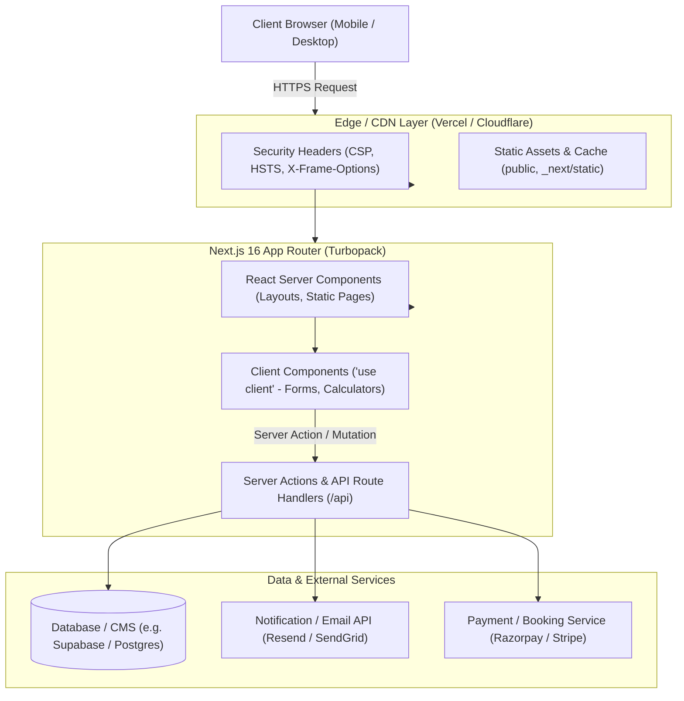

# Architecture Guide: Balance Diet Pune

This document provides a technical overview of the architecture, folder structure conventions, design decisions, and data flow patterns for the **Balance Diet Pune** web platform.

---

## 🏛️ High-Level System Architecture



---

## 📁 Directory Structure & Organization

```text
src/
├── app/                        # Next.js App Router routes & layouts
│   ├── api/                    # Route Handlers for external webhooks or REST endpoints
│   ├── appointments/           # Appointment booking route
│   ├── diet-plans/             # Diet plans & nutrition packages
│   ├── calculators/            # BMI / BMR / Calorie calculators
│   ├── layout.tsx              # Root HTML structure, fonts, meta tags
│   ├── page.tsx                # Homepage / Hero / Value proposition
│   ├── globals.css             # Tailwind v4 directives & theme configurations
│   └── not-found.tsx           # Custom 404 handler
├── components/                 # Reusable UI components
│   ├── ui/                     # Base primitives (Button, Modal, Card, Input)
│   ├── layout/                 # Site Header, Footer, Mobile Navigation
│   ├── forms/                  # Diet consultation forms & validations
│   └── calculators/            # Interactive nutrition calculators
├── lib/                        # Shared utility functions, DB clients, and helpers
│   ├── utils.ts                # General utility functions (cn, formatters)
│   ├── validations.ts          # Zod schemas for input validation
│   └── constants.ts            # Site configuration, contact details, pricing tiers
├── hooks/                      # Custom React client hooks
└── types/                      # Shared TypeScript type definitions
```

---

## ⚖️ Component Strategy: Server vs. Client

To achieve maximum performance, fast Initial Server Response (TTFB), and minimum client-side JavaScript bundle:

### When to use React Server Components (Default)
- Page layouts (`layout.tsx`)
- Content pages (`page.tsx`)
- Informational blocks (About Us, Services, FAQ, Testimonials)
- Direct database / CMS queries
- Sensitive backend business logic

### When to use Client Components (`'use client'`)
- Interactive calculators (BMI, BMR, Calorie targets)
- Appointment booking calendar pickers
- Mobile hamburger menu toggle
- Form inputs with real-time feedback and state
- Components needing React hooks (`useState`, `useEffect`, `useContext`)

---

## 🔒 Security Architecture

1. **HTTP Security Headers**: Enforced centrally in `next.config.ts`:
   - `Strict-Transport-Security`: Forces HTTPS for all requests.
   - `X-Frame-Options: DENY`: Prevents clickjacking attacks.
   - `X-Content-Type-Options: nosniff`: Prevents MIME type sniffing.
   - `Referrer-Policy: strict-origin-when-cross-origin`: Controls referrer data leakage.
   - `Permissions-Policy`: Restricts camera, microphone, and geolocation.
2. **Environment Variable Segregation**:
   - Variables prefixed with `NEXT_PUBLIC_` are bundled into client JavaScript.
   - Server-only secrets (`AUTH_SECRET`, database connection strings) are strictly hidden from the client.
3. **Input Validation**:
   - All server actions and API route handlers must validate incoming payloads against strict Zod schemas before processing.

---

## ⚡ Performance Optimization

- **Turbopack Build Pipeline**: Fast local compilation and component-level caching (`cacheComponents: true`).
- **Font Optimization**: Uses `next/font` for local font caching with zero layout shifts (CLS).
- **Image Optimization**: All images utilize `next/image` for automatic WebP/AVIF compression and responsive sizing.
- **Partial Prefetching**: Enabled in `next.config.ts` for instant route transitions.

